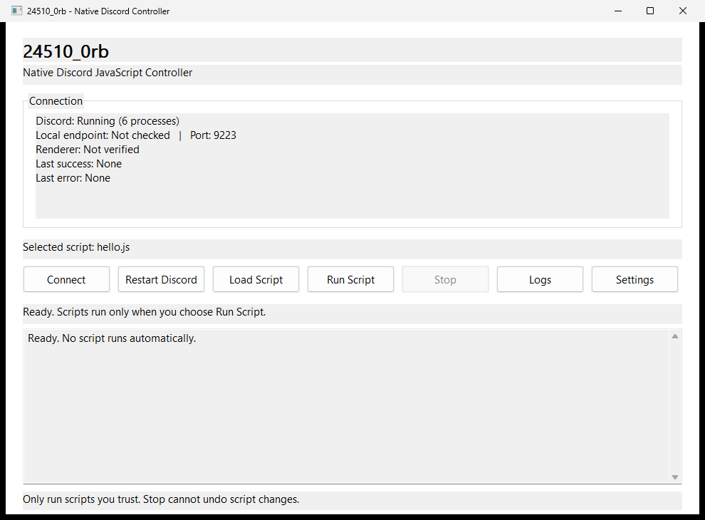
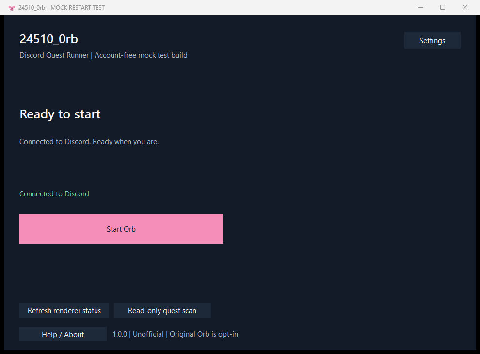
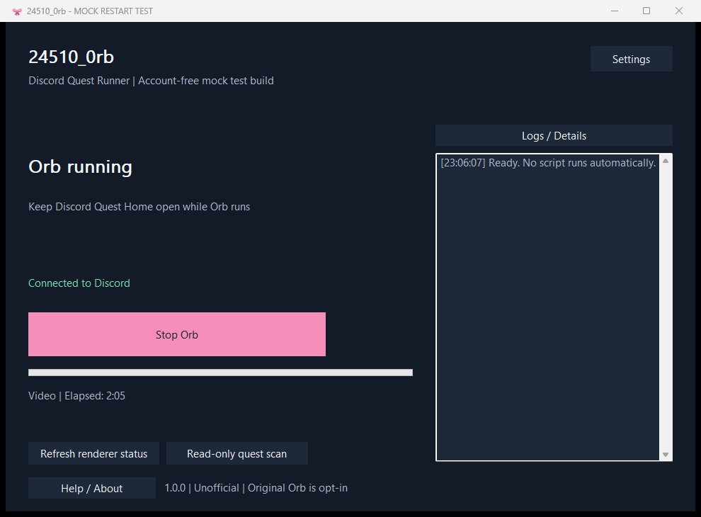
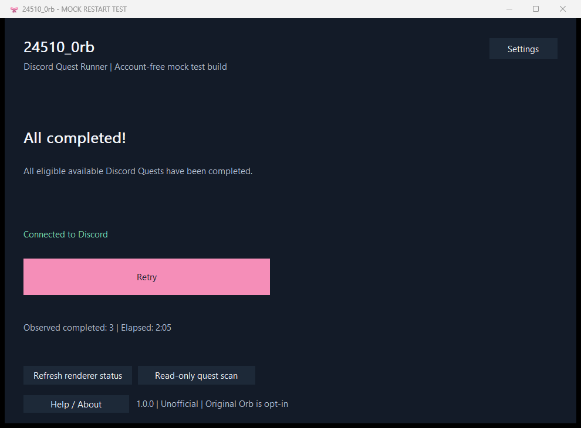
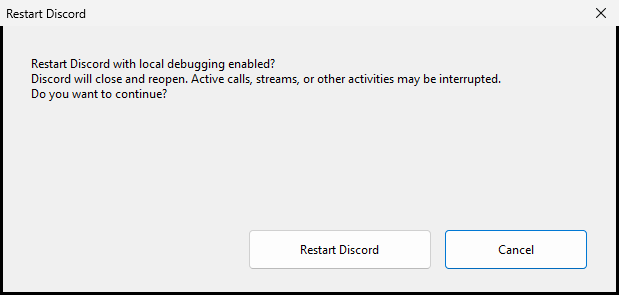

# 24510_0rb

**24510_0rb v1.0.2 (unreleased development build).**

**Latest public release: v1.0.1. v1.0.2 is under development and is not yet published.**

24510_0rb is a native C11 / Win32 controller for a consent-based Discord Quest experiment. It connects to an approved local renderer through CDP, reviews exact local JavaScript bytes, and presents bounded, privacy-conscious status. No Node.js, Python, Electron or Visual Studio runtime is required.

## Features

- Four clear primary actions: Restart Discord to Connect, Start Orb, Stop Orb, and All completed!/Retry.
- Unicode payload selection; per-run consent locks and hashes the exact bytes.
- Original Orb (experimental) import/review with separately attributed bundled original.
- Quick start/About, helper preflight and honest renderer stop requests.
- Configurable loopback port, bounded operation timeouts and readable errors.
- Renderer handshake verification with a timestamp, and Discord process state from the last check.
- Explicit restart consent, exact installed-image selection and graceful shutdown failure handling.
- Responsive workers, bounded logs and cancellation of the application's own helper.

### Historical v0.2 screenshots



*Historical v0.2 capture; not the v1.0.0 UI.*


### v1.0.0 mock-mode screenshots

| Ready | Running | All completed |
| --- | --- | --- |
|  |  |  |

*Mock-mode test captures; not live Discord validation.*

## v1.0.0 behavior

The four primary actions guide the run lifecycle. **Restart Discord to Connect** always asks for explicit confirmation. **Start Orb** requires explicit per-run consent; the in-app Discord page must be ready at `/quest-home` and remain open while it runs. **Stop Orb** makes a best-effort cooperative request and cannot guarantee cleanup or rollback. **All completed!** appears only after a reliable eligible-quest scan; **Retry** performs another read-only scan.

Nothing auto-starts on launch, Connect, restart, or file selection. Rate limits and unknown or unreliable renderer state fail closed: the app does not infer completion or automatically retry, and it blocks another start until a safe verified reset.

Mock-mode screenshots and synthetic tests do not validate live Discord behavior or real-account results.

v1.0.1 uses the approved Discord Update.exe --processStart path and validates the updater before shutdown. A later one-shot direct updater recovery on the real Stable installation returned exit 0, launched app-1.0.9261\Discord.exe with the requested loopback CDP flags, and exposed /json/version with HTTP 200. This verifies the installed updater command path only; the Orb GUI restart button and its native renderer handshake have not passed live acceptance. v1.0.2 development fixes the post-update version mismatch by rediscovering the running image and accepting only the same validated installation channel/root.


Choose **Original Orb (experimental)** to review the bundled original, or
**Select local .js...** to import a file without console copy/paste. Nothing
runs until you affirm the per-run warning and hash. The file is locked through
dispatch, and the helper checks its outgoing bytes against that SHA-256.
The self-starting original automatically enrolls/updates Quests and fakes
activity using the authenticated Discord client; it may violate Discord rules.
See [original permission and risk notice](legacy/NOTICE.md).

**Cancel helper** cancels only the local helper. **Request Orb stop** sends the
existing `window.stopQuestProgram()` hook if available and reports **Stop
requested / state unknown**, including when the hook is missing. It cannot
prove cleanup, rollback or completion. The controller blocks repeat starts
after an Original Orb dispatch attempt until a verified consent-based restart.
The latch is session-local; closing the controller does not stop renderer code.
One controller instance per desktop prevents accidental simultaneous windows.

Routine logs withhold renderer results, exceptions, events, titles, URLs and
raw version JSON, including with `--verbose`. Connect/Run/Stop/check refuse
foreign or wildcard listeners using the installed-process ownership policy.
Process checks reduce endpoint races but cannot provide an atomic Windows
socket-to-process guarantee. Installed paths are validated; no code-signing
or binary authenticity guarantee is claimed.

## Download and run

Download from the [latest release](https://github.com/0x440-1me/24510_0rb/releases/latest), or choose [v0.2.0](https://github.com/0x440-1me/24510_0rb/releases/tag/v0.2.0) on the [release page](https://github.com/0x440-1me/24510_0rb/releases). The v0.2.0 workflow produces these release files:

- `24510_0rb-v0.2.0-windows-x64.zip`
- `SHA256SUMS.txt`

Check the ZIP's SHA-256 against SHA256SUMS.txt, extract it into a writable folder, and run **24510_0rb.exe**. Keep **orb-cdp.exe** beside it and retain the payloads folder. The application selects hello.js at startup and does not run it automatically.

The tag workflow publishes only after its build, tests and package checks pass. See [Issue #2](https://github.com/0x440-1me/24510_0rb/issues/2) for publication and downloaded-release verification records; a build artifact alone is not a published release.

### Requirements

- Windows 10 version 1809 or later, or Windows 11, **x64**. Only the current Windows 11 development VM has live test evidence.
- An installed Discord stable/PTB/canary client and an authorized local debugging endpoint.
- No elevated permission is normally needed. The app requests asInvoker execution.

Build from source with MSYS2 UCRT64 GCC: see [BUILDING.md](BUILDING.md). The first verified hosted [PR build](https://github.com/0x440-1me/24510_0rb/actions/runs/38005830743) and [feature build](https://github.com/0x440-1me/24510_0rb/actions/runs/38005826992) passed account-free fixtures on Windows Server 2025: native process 52/52, Foundation 37/37 and mock GUI 27/27 with 310 assertions. These runs used GCC 16.2.0 Rev5; prior harmless real-CDP evidence came from a Windows 11 local build with Rev4, not the hosted binaries. See [current Actions](https://github.com/0x440-1me/24510_0rb/actions) and [test results](docs/test-results.md) for scope and provenance.

## Connect

1. Set the local debugging port in Settings (default **9223**).
2. Ensure Discord is exposing an endpoint through an authorized setup or use the consent-based restart feature where permitted.
3. Choose **Connect**. This discovers an approved Discord page, verifies its WebSocket handshake and closes the socket.

“Verified on demand” records a successful check; it does not mean the app holds an ongoing WebSocket. Changing the port or Discord selection clears old verification. Discord's process display is also a last-check snapshot.

## Restart with consent



*Historical v0.2 screenshot; not the v1.0.0 development UI.*

**Restart Discord** opens a warning about interrupted calls, streams and other activities. **Cancel is the default**; Cancel, Escape and the dialog close button leave Discord untouched. Only the affirmative button starts the restart worker.

The app selects an approved installation, checks IPv4/IPv6 port ownership, requests ordinary window close, waits for exit, rechecks the port and launches the selected executable with loopback-only debugging arguments. It never force-kills Discord. Multiple installed/running channels may require an explicit approved executable in Settings.

Tray-only clients, a close-to-tray setting, incomplete discovery, port conflicts and shutdown timeouts can stop the operation. A failure after shutdown may leave Discord stopped; cancellation after launch reports that launch occurred and asks you to check its process state. The shared restart flow and affirmative GUI path are mock-tested. **The user reported a previous manual Windows 11 result; it was not independently observed and is not v1.0.0 validation or evidence for a public binary. Automated live restart remains unverified.** Do not use the application to circumvent an execution guard.

## External payloads

Choose **Load Script**, select a trusted `.js` file, then choose **Run Script** and confirm that run. Edit that file and review/confirm again to evaluate its current contents. A harmless example is:

```javascript
(() => {
  console.log("Hello from 24510_0rb");
  return "HELLO_OK";
})()
```

Included hello.js returns a marker; banner.js displays a removable banner. Scripts are evaluated in the Discord renderer and can affect its state. Run only code you understand and have permission to execute. **Stop cannot undo code already evaluated or reliably stop asynchronous work already running inside Discord.**

## Troubleshooting

| Symptom | Action |
| --- | --- |
| Endpoint unavailable | Check the configured port and authorized Discord debugging setup. |
| Renderer not found | Confirm the endpoint belongs to a supported Discord page; lookalike titles/domains are rejected. |
| Native controller could not start | Keep orb-cdp.exe in the extracted app folder. |
| JavaScript exception | Details are withheld for privacy; review the trusted external source locally. |
| Port conflict | Choose a free local port; foreign or wildcard listeners cannot be reused for restart. |
| Graceful exit timeout / no window | Quit Discord manually through its own controls where authorized, then retry an authorized setup. No force-kill fallback exists. |
| Installation ambiguous | Select an approved installed Discord executable in Settings. |
| Invalid preferences | Invalid/missing numeric fields fall back to defaults. Repair invalid optional paths in Settings. |
| Test script refused by policy | Use an already approved PowerShell environment or report the refusal. Test scripts never change or bypass policy. |

## Security, status and limitations

This is an **unofficial** Discord integration, unaffiliated with Discord. Internal renderer/CDP behavior can change. Local debugging exposes privileged script access; keep it on loopback and do not run untrusted payloads. This project does not test Quest spoofing, account automation or anti-abuse evasion. See [SECURITY.md](SECURITY.md), [test results](docs/test-results.md) and [architecture](docs/architecture.md).

Validated behavior includes harmless real renderer handshake/evaluation/exceptions/Unicode file edits, mock restart sequencing/UI, consent cancellation, responsive Stop and cleanup. The manual restart result above is user-reported. Physical DPI monitor migration, injected allocation/window/result-post failures and independently observed normal live restart remain unverified. Stop may leave already-evaluated effects in place. A worker busy during window close is cancelled before the app finishes closing.

## Legacy and license

The original script and historical readme remain byte-for-byte unchanged in
the repository's **legacy/** directory, attributed to **0x440_1me**. The owner
confirmed authorship and authorized bundling the unchanged script on
2026-10-10. The portable package includes the script, `legacy/NOTICE.md` and
`legacy/README.md`; it excludes the historical original readme. Tests only
hash/copy the original; synthetic fixtures are the execution inputs.

[LICENSE](LICENSE) grants MIT terms only to the native/support files and
explicitly excludes the original. [NOTICE](legacy/NOTICE.md) records the
separate permission and its scope. Owner attestation does not establish all
third-party rights; other distribution or relicensing needs verification.
